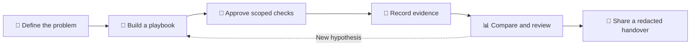

<div align="center">

  

  <h1>Rootlith Studio</h1>

  <p><strong>Follow the evidence. Make troubleshooting repeatable.</strong></p>
  <p>A local-first visual investigation workbench for technicians, support engineers, and curious problem-solvers.</p>

  <p>
    <a href="LICENSE"></a>
    
    
    
  </p>

  <p>
    <a href="#-quick-start"><strong>Explore the source</strong></a> &nbsp;·&nbsp;
    <a href="#-what-you-can-do"><strong>Features</strong></a> &nbsp;·&nbsp;
    <a href="#-contribute"><strong>Contribute</strong></a> &nbsp;·&nbsp;
    <a href="https://klowzy.com"><strong>KLOWZY</strong></a>
  </p>

</div>

---

## Troubleshooting should tell a story.

A screenshot with no context. A test nobody remembers running. A fix that works once, then disappears into chat history.

**Rootlith Studio brings the investigation together.** Map a diagnostic path, explicitly choose what to test, capture observations, compare outcomes, and hand over an understandable record instead of a pile of disconnected notes.

It is an **evidence and workflow tool**, not an autonomous repair agent or a vulnerability scanner. The goal is to support your judgment, never replace it.

## ✨ What you can do

| Explore | Investigate | Explain | Reuse |
| :--- | :--- | :--- | :--- |
| **Visual playbooks** — sketch questions, branches, and next steps | **Case workbench** — organize targets, actions, evidence, and history | **Evidence-aware handovers** — review and redact what you share | **Local investigation kits** — start the next case with a proven workflow |
| Guided workflow editor and inspection tools | Explicitly approved, bounded read-only checks | Comparisons, timelines, and report previews | Local backups, controlled imports, and reusable templates |

### One investigation, from first question to clear handover



**Examples of investigations:** document an intermittent connectivity issue, compare two observations of a service, or build a reusable triage path for a recurring support problem. Each example is a workflow to guide a human investigator, **not** a claim that Rootlith identifies root causes automatically.

## 🧠 Designed to keep you in control

- **Local-first:** core workspaces live on your device. No account, subscription, AI service, or telemetry is required.
- **Read-only by design:** supported diagnostics request explicit authorization for an exact target and bounded operation; imported playbooks cannot execute arbitrary shell commands.
- **Your evidence, your choice:** exported reports have privacy-conscious defaults, and sharing requires reviewing the actual preview.
- **Honest limits:** a read-only request can still be logged, consume resources, or interact with a sensitive service. Only investigate systems you own or are authorized to test.

> [!IMPORTANT]
> **Current release state: v0.13.0-alpha.1 source preview.** This repository is intended for collaboration and review. It does **not** yet provide a publicly validated Windows Installer or Portable release. Linux/browser build success does not establish Windows-native upgrade or packaging safety. The manual update feature is not yet a public download channel.

## 🚀 Quick start

**Requirements:** Node.js 24 LTS and npm. Windows is the intended native desktop platform; other environments can inspect the code and run the browser development experience.

```bash
git clone https://github.com/KlowzyZ/Rootlith-Studio.git
cd Rootlith-Studio
npm ci
npm run dev
```

Open the local address printed by Vite. **Browser mode simulates desktop diagnostics; it does not execute native Windows checks.**

For source verification:

```bash
npm run lint
npm run typecheck
npm test
npm run build
```

On a system with a supported graphical environment, `npm run desktop` builds and launches Electron from source. For Windows packaging requirements, native limitations, and license obligations, see [Building](docs/building.md) and [Packaging notices](PACKAGING_NOTICES.md). Do not distribute an unreviewed local package as an official Rootlith release.

## 🧰 How it is built

| Layer | Responsibility |
| :--- | :--- |
| **React + TypeScript** | Visual editor, cases, timeline and workbench |
| **Workflow engine + schemas** | Validated branching, bounded interpretation and data structures |
| **Electron desktop boundary** | Native storage, controlled IPC and explicitly approved diagnostics |
| **Local project files** | Playbooks, reports, backups and reviewed exports |

Start with [Architecture](docs/architecture.md), [Playbook format](docs/playbook-format.md), or [Native storage](docs/native-storage.md).

## 🤝 Contribute

**Rootlith is open source because the best diagnostic workflows come from people who actually solve problems.** Bring a real use case, an idea, a small fix, or a synthetic playbook. You do not need to be an expert in every part of the project.

Good ways to help:

- Improve documentation and first-run clarity.
- Suggest a practical, privacy-safe workflow or investigation kit.
- Report reproducible UI and accessibility issues using synthetic data.
- Propose bounded, explicitly approved diagnostics with a clear safety model.

Open an [issue](https://github.com/KlowzyZ/Rootlith-Studio/issues) or [pull request](https://github.com/KlowzyZ/Rootlith-Studio/pulls) after reviewing [CONTRIBUTING.md](CONTRIBUTING.md) and [CODE_OF_CONDUCT.md](CODE_OF_CONDUCT.md). Contributions are reviewed; a proposed feature is not a promise of implementation. Never submit private client reports, credentials, or sensitive network details.

If you find a security issue, **do not open a public exploit report**. Follow [SECURITY.md](SECURITY.md) for private vulnerability reporting.

## 🔐 Privacy, licensing & transparency

Rootlith Studio is published under the [MIT license](LICENSE). Third-party packages and installer components retain their own licenses; see [Third-party notices](THIRD_PARTY_NOTICES.md) and [Packaging notices](PACKAGING_NOTICES.md).

Local workspaces and recovery backups are **not encrypted**. Redaction is an aid, not a guarantee that an exported document is safe to publish. The source being open to inspection does **not** certify the app as secure. Please assess suitability for your environment before using it with sensitive records.

---

<div align="center">
  <p><strong>From a messy investigation to knowledge you can actually share.</strong></p>
  <p>Made by <a href="https://klowzy.com"><strong>KLOWZY</strong></a> · Built with care · Open to thoughtful contributions</p>
  <p>If Rootlith helps you or sparks an idea, consider giving the repository a ⭐ — and tell us what you would improve.</p>
</div>
